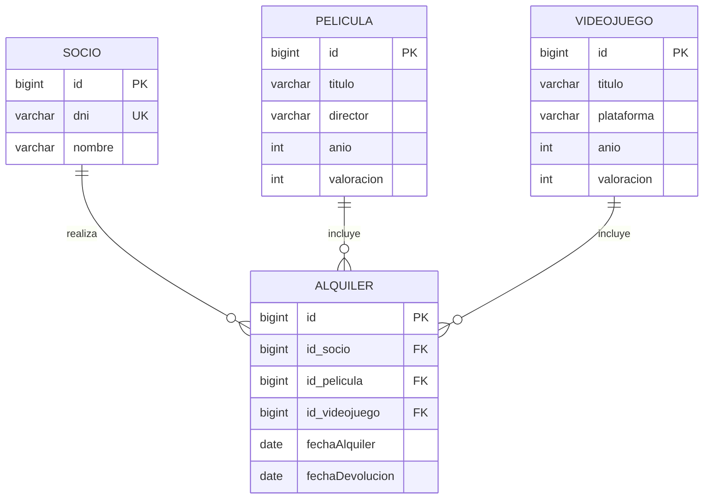

# 📼 RetroVideo - Sistema de Gestión de Videoclub

**RetroVideo** es una aplicación integral para la gestión de un videoclub moderno (películas y videojuegos), desarrollada como **Proyecto Final Intermodular de 1º de DAW** en el **IES Severo Ochoa**.

El proyecto integra en un único Producto Mínimo Viable (MVP) el diseño de bases de datos relacionales, la lógica de negocio y persistencia mediante ORM en Java, el diseño de una interfaz web *responsive* y la especificación de una API REST con OpenAPI 3.0.

---

## ✨ Funcionalidades Principales

- **Gestión de Catálogo (CRUD Completo):**
  - Alta, listado, edición y eliminación de **Películas** ([`Pelicula.java`](backend/src/main/java/model/Pelicula.java)) y **Videojuegos** ([`Videojuego.java`](backend/src/main/java/model/Videojuego.java)).
  - Consultas personalizadas y filtrado por **año de lanzamiento** y **valoración mínima** mediante *NamedQueries* y consultas JPQL parametrizadas ([`PeliculaDAO.java`](backend/src/main/java/dao/PeliculaDAO.java)).
- **Gestión de Socios:**
  - Registro y listado de clientes ([`Socio.java`](backend/src/main/java/model/Socio.java)) con validación de identidad única (`DNI` con restricción `UNIQUE` en base de datos) y búsqueda por DNI.
- **Sistema de Alquileres, Devoluciones e Informes:**
  - Registro de préstamos ([`Alquiler.java`](backend/src/main/java/model/Alquiler.java)) asociando un socio con una película o un videojuego.
  - Cálculo automático de la fecha de alquiler (`LocalDate.now()`) y de la fecha límite de devolución (+3 días).
  - Gestión de **devoluciones** de alquileres activos ([`devolverAlquiler`](backend/src/main/java/dao/PeliculaDAO.java)) liberando la disponibilidad del artículo.
  - Generación de informes detallados por consola de películas y videojuegos actualmente alquilados.
- **Aplicación Web Interactiva (SPA) y Responsive:**
  - Interfaz moderna en modo oscuro ([`frontend/index.html`](frontend/index.html), [`frontend/style.css`](frontend/style.css) y [`frontend/app.js`](frontend/app.js)), adaptable a móviles, tablets y escritorio mediante **CSS Grid** y *Media Queries*.
  - **Buscador y filtros en tiempo real** (por texto, categoría, valoración mínima y disponibilidad), panel de KPIs, alta de socios con validación de DNI (`8 dígitos + letra` y control de duplicados), gestión de préstamos/devoluciones con `localStorage` y un **Simulador de API REST (OpenAPI 3.0)** en vivo.
- **Diseño de API REST (OpenAPI 3.0):**
  - Especificación técnica completa en [`docs/api/openapi.yaml`](docs/api/openapi.yaml) (`/peliculas`, `/videojuegos`, `/socios` y `/alquileres`) junto con análisis de dominio ([`1-analisis-dominio.md`](docs/api/ejemplos-json/1-analisis-dominio.md)) y payloads JSON de ejemplo.

---

## 🛠️ Tecnologías Utilizadas

| Capa | Tecnologías y Herramientas |
| :--- | :--- |
| **Backend** | Java 21, Jakarta Persistence API (JPA 3.1), Hibernate ORM 6.4, Maven |
| **Base de Datos** | MySQL / MariaDB, JDBC (`mysql-connector-j` 8.3) |
| **Frontend** | HTML5 Semántico, CSS3 (Custom Properties, Flexbox, CSS Grid, Responsive Design), JavaScript (Vanilla) |
| **Documentación API** | OpenAPI 3.0 (Swagger), JSON, Markdown |
| **Arquitectura y Patrones** | Patrón DAO (*Data Access Object*), ORM, Separación de responsabilidades |

---

## 🗂️ Estructura del Proyecto

```text
RetroVideo/
├── backend/                  # Aplicación Java 21 con Maven, JPA e Hibernate
│   ├── src/main/java/
│   │   ├── app/Main.java     # Interfaz de consola interactiva (19 opciones)
│   │   ├── dao/PeliculaDAO.java # Operaciones CRUD, transacciones y consultas JPQL
│   │   └── model/            # Entidades JPA: Pelicula, Videojuego, Socio, Alquiler
│   ├── src/main/resources/
│   │   └── META-INF/persistence.xml # Configuración de la unidad de persistencia
│   └── pom.xml               # Dependencias de Maven
├── database/
│   └── videoclub.sql         # Script SQL con estructura de tablas y datos iniciales
├── docs/api/
│   ├── openapi.yaml          # Especificación OpenAPI 3.0 de la API REST
│   └── ejemplos-json/        # Análisis del dominio y ejemplos de peticiones/respuestas
└── frontend/
    ├── index.html            # Interfaz web interactiva (Catálogo, Alquileres, Socios y Modales)
    ├── style.css             # Hoja de estilos responsive (CSS Grid, Flexbox, Dark Theme)
    └── app.js                # Lógica SPA, filtros en vivo, persistencia localStorage e Inspector API
```

### Modelo de Datos (Entidad-Relación)



---

## 🚀 Instrucciones de Instalación y Ejecución

### Requisitos previos
- **JDK 21** o superior instalado.
- **Maven** (o un IDE con soporte integrado como IntelliJ IDEA / Eclipse).
- Servidor **MySQL** o **MariaDB** activo en el puerto `3306` (por ejemplo, mediante XAMPP).

### 1. Configurar la Base de Datos
1. Inicia tu servidor MySQL/MariaDB.
2. Importa el archivo [`database/videoclub.sql`](database/videoclub.sql) desde tu gestor de bases de datos (phpMyAdmin, DBeaver, MySQL Workbench) o por terminal:
   ```bash
   mysql -u root -p -e "CREATE DATABASE IF NOT EXISTS videoclub;"
   mysql -u root -p videoclub < database/videoclub.sql
   ```
   > **Nota:** La unidad de persistencia en [`persistence.xml`](backend/src/main/resources/META-INF/persistence.xml) viene preconfigurada para desarrollo local (`usuario: root`, sin contraseña) y cuenta con `createDatabaseIfNotExist=true` y `hibernate.hbm2ddl.auto=update`, por lo que Hibernate también puede generar el esquema automáticamente e insertar los datos semilla al iniciar [`Main.java`](backend/src/main/java/app/Main.java).

### 2. Ejecutar el Backend (Consola Interactiva)
1. Abre la carpeta [`backend/`](backend) como proyecto Maven en tu IDE (IntelliJ IDEA o Eclipse).
2. Espera a que Maven descargue las dependencias definidas en [`backend/pom.xml`](backend/pom.xml).
3. Ejecuta la clase principal [`app.Main`](backend/src/main/java/app/Main.java).
4. Interactúa con las 19 opciones del menú de consola para gestionar películas, videojuegos, socios y alquileres.

### 3. Visualizar el Frontend y la Documentación API
- **Frontend Web:** Abre el archivo [`frontend/index.html`](frontend/index.html) directamente en cualquier navegador web (o usando la extensión *Live Server* en VS Code).
- **API REST (OpenAPI):** Abre el archivo [`docs/api/openapi.yaml`](docs/api/openapi.yaml) en [Swagger Editor](https://editor.swagger.io/) o mediante una extensión de OpenAPI en tu IDE para explorar los *endpoints* y esquemas interactivos.

---

## 📸 Demostración y Vista Previa

### Menú Principal del Backend (Consola Java)
```text
=======================================================
          SISTEMA DE GESTIÓN RETROVIDEO v1.5           
=======================================================
1. Añadir Película         2. Listar Películas
3. Añadir Videojuego       4. Listar Videojuegos
5. Registrar Socio         6. Listar Socios
-------------------------------------------------------
7. ALQUILAR PELÍCULAS      8. ALQUILAR VIDEOJUEGOS
-------------------------------------------------------
9.  Películas Alquiladas   10. Videojuegos Alquilados 
11. Eliminar Película      12. Eliminar Videojuego
13. Buscar Peli por Año    14. Buscar Peli por Val.
15. Buscar Juego por Año   16. Buscar Juego por Val.
17. Modificar Película     18. Modificar Videojuego
19. Devolver Alquiler      20. Salir
Selecciona una opción:
```

> 💡 *(Opcional: Puedes añadir aquí una captura de pantalla de la web guardándola en `docs/img/preview.png` y enlazándola con ``)*

---

## 🔄 Metodología de Trabajo
El desarrollo se ha estructurado siguiendo buenas prácticas de ingeniería del software:
- **Modularidad:** Separación clara entre persistencia (`dao`), modelo de dominio (`model`), interfaz de usuario (`app` / `frontend`) y contratos de API (`docs/api`).
- **Gestión de Transacciones:** Encapsulación de transacciones ACID mediante expresiones lambda (`Consumer<EntityManager>`) con *rollback* automático ante fallos en [`PeliculaDAO.java`](backend/src/main/java/dao/PeliculaDAO.java).
- **Control de Versiones (Git Flow):** Trabajo por ramas de funcionalidad (`feature/...`) e integración mediante *Pull Requests* hacia la rama principal `main`.

---

## 👤 Autor

**Adrián Martínez**  
Estudiante de Desarrollo de Aplicaciones Web (1º DAW - Curso 2025/2026) — *IES Severo Ochoa*
